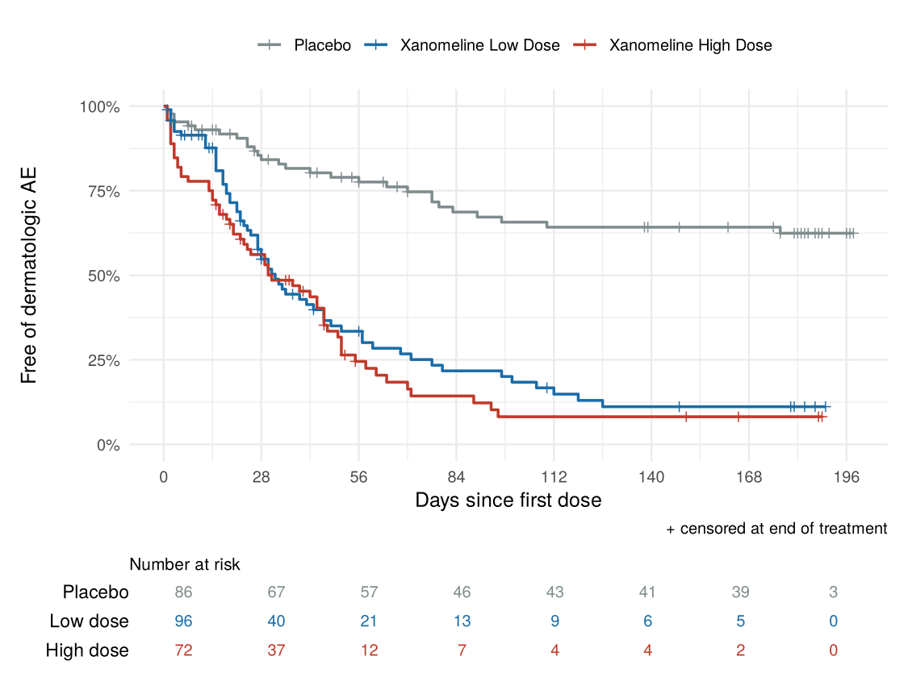

# Clinical Trial Analysis: SDTM → ADaM → TLFs in R

An end-to-end safety analysis of a randomized clinical trial, following the workflow used in pharmaceutical statistical programming:

**SAP → SDTM → ADaM (admiral) → independent QC → Tables, Listings and Figures**

The data are the public **CDISC SDTM pilot study** (CDISCPILOT01) distributed in the [`pharmaversesdtm`](https://github.com/pharmaverse/pharmaversesdtm) package: a 24-week, double-blind, placebo-controlled phase II trial of the xanomeline transdermal patch in mild to moderate Alzheimer's disease (254 treated patients).

## What is in this repository

| Step | File | Description |
|---|---|---|
| 1. Analysis plan | [`sap/SAP.md`](sap/SAP.md) | Pre-specified populations, endpoint derivations, statistical methods and TLF list, with revision history |
| 2. ADaM programming | [`R/01_adsl.R`](R/01_adsl.R) | **ADSL** (subject level): treatment dates, disposition, population flags |
| | [`R/02_adae.R`](R/02_adae.R) | **ADAE** (adverse events): date imputation, treatment-emergent flag, dermatologic event flag |
| | [`R/03_adtte.R`](R/03_adtte.R) | **ADTTE** (time to event): time to first dermatologic AE with event and censoring sources |
| 3. Independent QC | [`qc/qc_adtte.R`](qc/qc_adtte.R) | Re-derives the primary endpoint from SDTM in base R (no admiral) and compares record by record ([log](qc/qc_log.txt)) |
| 4. TLFs | [`tlf/tlf.md`](tlf/tlf.md) | Disposition, demographics, TEAE overview, TEAEs by SOC/PT, time-to-event table, Kaplan–Meier figure, listing of deaths |
| Outputs | `data/adam/*.xpt` | ADaM datasets in SAS transport v5 format, the FDA submission format |

## Primary endpoint

**Time to first dermatologic adverse event** during treatment. The xanomeline patch is applied to the skin, so application-site and skin reactions are the key safety question. The SAP defines a dermatologic event as any application-site PT or any PT in the *Skin and subcutaneous tissue disorders* SOC, excluding hyperhidrosis, cold sweat and alopecia.



| | Placebo (N=86) | Xanomeline Low Dose (N=96) | Xanomeline High Dose (N=72) |
|---|---:|---:|---:|
| Patients with event | 28 (32.6%) | 62 (64.6%) | 58 (80.6%) |
| Median time to event, days | Not reached | 32 | 31 |
| Hazard ratio vs. placebo (95% CI) | Reference | 4.29 (2.72, 6.77) | 5.30 (3.33, 8.44) |

Both doses were associated with a 4- to 5-fold higher hazard of a first dermatologic event compared with placebo (log-rank p < 0.0001), and about 80% of events occurred within the first 8 weeks of treatment. There was no evidence against proportional hazards (Schoenfeld global p = 0.60). Discontinuation due to adverse events was also far more common with xanomeline (Table 14.1.1), and 61 of the 84 xanomeline patients who discontinued for that reason had a dermatologic TEAE. The data do not record which event led to withdrawal, so this is an association rather than an attribution.

## Quality control

Pharmaceutical analyses are usually **double programmed**: a second programmer derives key datasets independently, and the two versions must match before results are released. Here, `qc/qc_adtte.R` re-derives ADTTE from the raw SDTM domains using only base R, including the population, treatment dates, partial-date imputation and the dermatologic event definition. It then checks every record and the Table 14.3.3 event counts and hazard ratios against production:

```
QC of ADTTE (TTDE)
  Subjects: production 254 | QC 254
  Mismatched records: 0
  RESULT: production and QC agree.
```

## Reproducing

```r
# R >= 4.1
install.packages(c("admiral", "pharmaversesdtm", "dplyr", "tidyr", "stringr", "survival",
                   "ggplot2", "patchwork", "haven", "rmarkdown", "knitr"))
```

From the repository root, run `Rscript run_all.R`. This builds ADSL → ADAE → ADTTE, exports the `.xpt` files, runs the QC (which stops the pipeline on any mismatch), then renders `tlf/tlf.md`. The outputs here were produced with R 4.3.3, admiral 1.3.1 and the GitHub development version of pharmaversesdtm (1.5.0.9003).

## Scope and limitations

- This is a portfolio exercise on public demonstration data, not a regulatory analysis. The SAP is my own, written for this exercise; it is not the sponsor's SAP.
- Efficacy endpoints (ADAS-Cog, CIBIC+) are not analysed because the questionnaire domain is not part of the public SDTM package.
- Tables are produced with `dplyr` and `knitr` rather than a dedicated TLF package, so the formatting is simpler than a submission-ready RTF output.

## Glossary

**SAP**: Statistical Analysis Plan · **CDISC**: Clinical Data Interchange Standards Consortium · **SDTM**: Study Data Tabulation Model (standardized collected data) · **ADaM**: Analysis Data Model (analysis-ready datasets) · **ADSL / ADAE / ADTTE**: subject-level, adverse event and time-to-event ADaM datasets · **TEAE**: treatment-emergent adverse event · **SOC / PT**: MedDRA system organ class / preferred term · **TLF**: Tables, Listings and Figures

## Author

Caroline Song · MS Biostatistics, Harvard T.H. Chan School of Public Health
